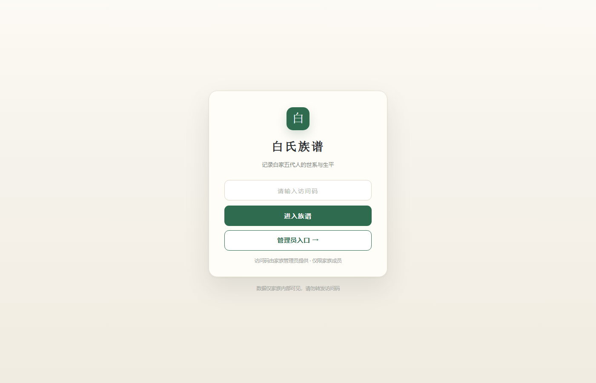
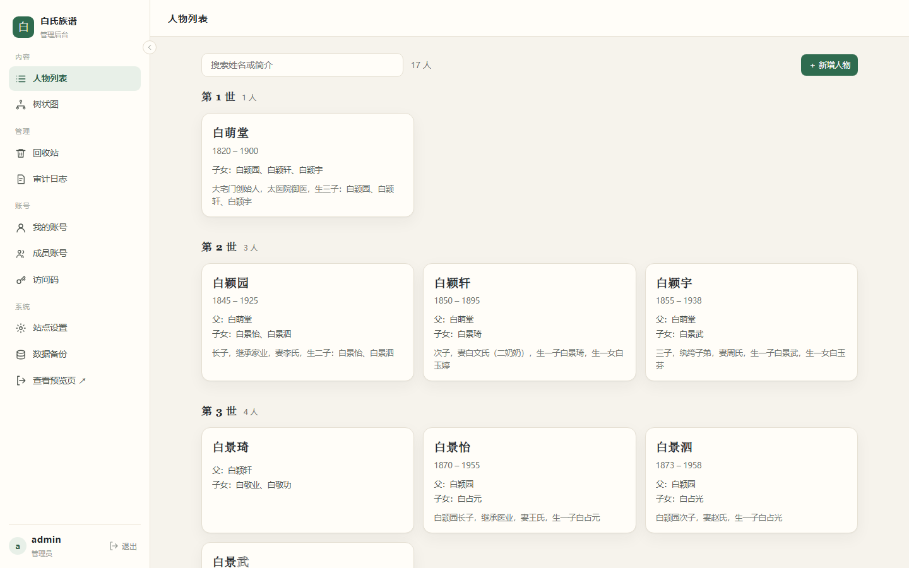
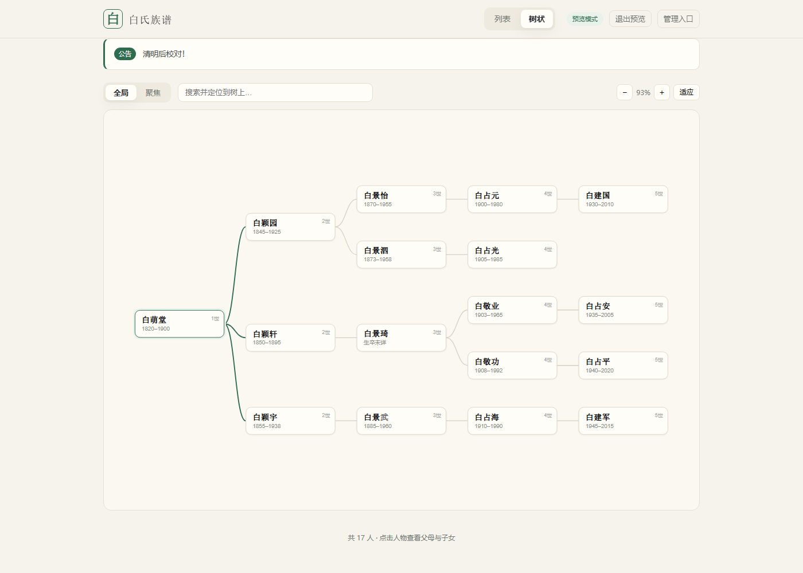
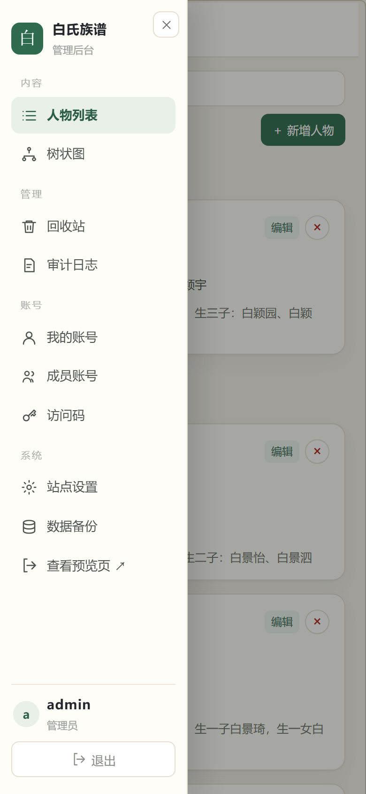
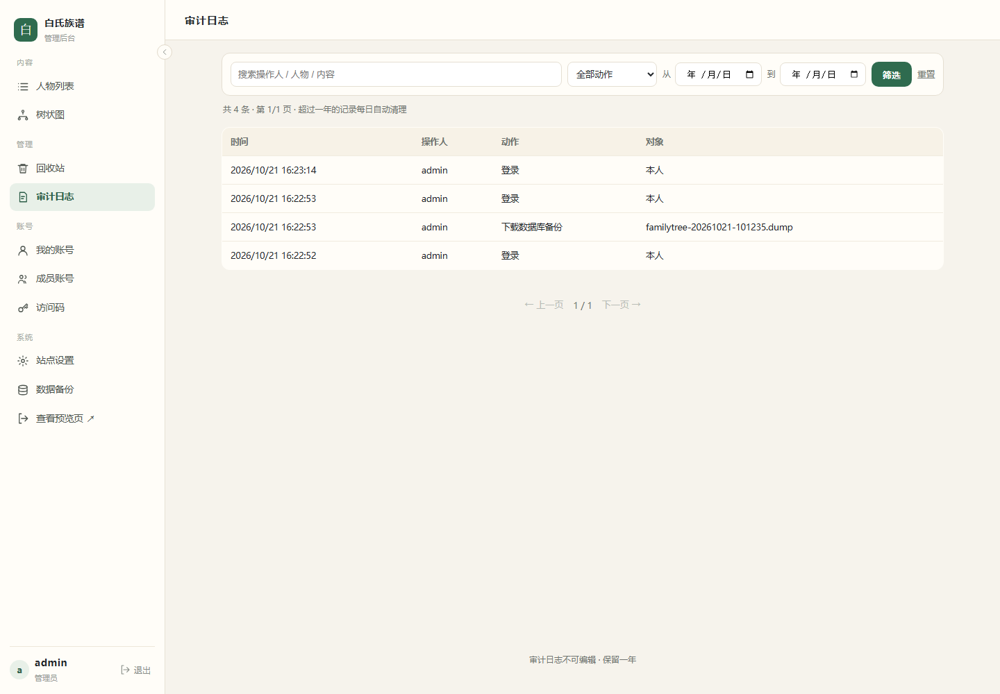
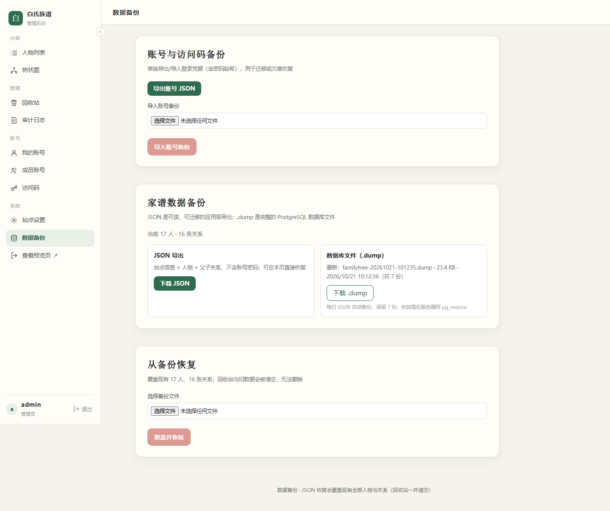

# 族谱 · Family Tree

一个可自托管的家族族谱系统：**访问码只读预览 + 管理员维护**，带树状图、公告、审计日志、每日备份与移动端适配。

> **来源声明**：本项目是 **[qiaoshouqing/familytree](https://github.com/qiaoshouqing/familytree)**（MIT）的**修改版本**，不是从零编写。原项目提供了 Next.js 家谱展示思路与示例数据；本仓库在其基础上重写了存储、鉴权、权限、审计与备份。详见 [UPSTREAM.md](UPSTREAM.md)。

[English](README.en.md) · [部署文档](docs/DEPLOYMENT.md) · [HTTPS 配置](docs/HTTPS.md) · [架构说明](docs/ARCHITECTURE.md) · [变更记录](docs/CHANGELOG.md)

[](LICENSE)
[](https://nextjs.org/)
[](https://www.postgresql.org/)
[](https://docs.docker.com/compose/)

---

## 截图

| 访问码首页 | 管理首页 |
|---|---|
|  |  |

| 树状图 | 手机端抽屉 |
|---|---|
|  |  |

| 审计日志 | 数据备份 |
|---|---|
|  |  |

> 截图为当前版本在 HTTPS 环境下的实际界面；「白家」数据来自示例文件，属于虚构演示内容，请替换为你自己的族谱。

---

## 功能

**族人（访问码）**
- 输入访问码查看人物列表与树状图，只读
- 列表按世代分组；树状图支持全局/聚焦三代、缩放、搜索定位
- 登录后可见公告栏；可随时「退出预览」
- 会话级 Cookie，关闭浏览器即失效，服务端最长 12 小时

**管理员（账号密码）**
- 人物增删改查：父子关系、生卒年、籍贯、安葬地、生平
- 世代自动计算；乐观锁防并发覆盖；防环校验
- 删除进回收站（30 天），单击删除 + 10 秒撤销
- 回收站恢复 / 彻底删除（需输入 DELETE）
- 审计日志：分页、关键词/动作/日期筛选，保留一年
- 成员账号：新增、改名、改角色、停用、重置密码、删除
- 访问码：可多个，可停用/删除，删除即让预览会话失效
- 站点设置：标题、简介、印章/Logo、公告
- 数据备份：账号 JSON、族谱 JSON、数据库 `.dump` 下载与恢复

**工程**
- Docker Compose 一键部署（5 服务）
- PostgreSQL 持久化 + 每日 03:00 自动备份（保留 7 份）
- 角色只有 `admin` / `user` 两级，页面与 API 双重校验
- 移动端：侧边栏抽屉、表格横向滚动、表单通栏

---

## 技术栈

| 层 | 选型 |
|---|---|
| 框架 | Next.js 15（App Router，standalone） |
| UI | React 19，原生 CSS |
| 数据库 | PostgreSQL 17 |
| 运行时 | Node.js 22 |
| 部署 | Docker Compose |

---

## 快速开始（Docker）

```bash
git clone <this-repo>
cd familytree

cp .env.example .env
# 至少修改：
#   POSTGRES_PASSWORD
#   DATABASE_URL（密码与上面一致）

docker compose up -d --build
```

首次启动会自动建表并导入 `seed/family-data.json`（17 人示例）。

- 族人入口：`http://localhost:3001/`
- 管理入口：首页「进入族谱」下方的「管理员入口」
- 默认管理员：`admin` / `admin`
- 默认访问码：`welcome`

> 默认账号和访问码只用于首次体验，**部署后请立刻修改**。放在反向代理后面时，
> 设置 `TRUST_PROXY=1`（并确保代理覆盖 `X-Forwarded-For`）；启用 HTTPS 后设置
> `COOKIE_SECURE=1`。生产环境请按 [docs/HTTPS.md](docs/HTTPS.md) 配置 TLS；
> 裸 HTTP 只适合完全可信的内网。

### 使用预构建镜像

从 [Releases](https://github.com/RSRFJ/family-tree/releases/tag/v1.0.0) 下载
`familytree-v1.0.0-images.tar.gz`（约 181 MB，不在 Git 仓库内，说明见 [docs/IMAGES.md](docs/IMAGES.md)）：

```bash
docker load -i familytree-v1.0.0-images.tar.gz
cp compose.release.yaml compose.yaml   # 或 -f compose.release.yaml
docker compose -f compose.release.yaml up -d
```

---

## 本地开发

```bash
npm install
cp .env.example .env      # DATABASE_URL 指向本地 Postgres

node --env-file=.env scripts/migrate.mjs
node --env-file=.env scripts/seed.mjs seed/family-data.json
npm run dev               # http://localhost:3000
```

生产构建：

```bash
npm run build && npm start
```

---

## 配置

| 变量 | 必填 | 说明 |
|---|---|---|
| `POSTGRES_DB` / `POSTGRES_USER` | 否 | 默认 `familytree` |
| `POSTGRES_PASSWORD` | 是 | 数据库密码 |
| `DATABASE_URL` | 是 | `postgres://用户:密码@db:5432/库名`，必须与上面一致 |
| `ADMIN_USER` / `ADMIN_PASSWORD` | 是 | 首次初始化的管理员 |
| `PREVIEW_CODE` | 否 | 首次导入的默认访问码 |
| `WEB_PORT` | 否 | 对外端口，默认 3001 |
| `TZ` | 否 | 时区 |

> `ADMIN_*` 与 `PREVIEW_CODE` 只在**空库第一次启动**时生效，之后在管理页修改。

---

## 权限

| 能力 | admin | user |
|---|---|---|
| 查看列表 / 树状图 | ✅ | ✅ |
| 新增 / 编辑 / 删除人物 | ✅ | ✅ |
| 回收站、恢复、彻底删除 | ✅ | ❌ |
| 审计日志 | ✅ | ❌ |
| 站点设置 | ✅ | ❌ |
| 数据备份 / 恢复 | ✅ | ❌ |
| 成员账号 / 访问码 | ✅ | ❌ |
| 修改自己的密码 | ✅ | ✅ |

保护规则：默认 `admin` 账号不可删除（只能停用）；停用/降级时至少保留一个启用管理员；不能停用自己。

---

## 数据与备份

- 数据库文件：`data/postgres`
- 每日 03:00：清理一年前审计 → `pg_dump` → 保留 7 份到 `data/backups`
- 管理页「数据备份」可下载：账号 JSON、族谱 JSON、最新 `.dump`
- 恢复：JSON 在页面导入；`.dump` 用 `pg_restore`（见部署文档）

---

## 目录结构

```
├── src/app/            # 页面与 API
├── src/lib/            # db / auth / session / preview / validate
├── src/app/components/ # 列表、树状图、访问码页
├── db/schema.sql       # 表结构、触发器、角色约束
├── scripts/            # migrate / seed / password
├── docker/backup/      # 每日备份容器
├── seed/               # 示例族谱
├── docs/               # 部署、架构、截图
├── compose.yaml        # 源码构建
└── compose.release.yaml# 预构建镜像
```

---

## 文档

- [部署与运维](docs/DEPLOYMENT.md)
- [架构与数据模型](docs/ARCHITECTURE.md)
- [变更记录](docs/CHANGELOG.md)

---

## Roadmap

- [ ] 母系与配偶关系
- [ ] 树状图虚拟化（500+ 人）
- [ ] 导入 GEDCOM
- [ ] Playwright 冒烟测试
- [ ] 可选对象存储头像/照片

---

## License

MIT。基于 [qiaoshouqing/familytree](https://github.com/qiaoshouqing/familytree)（MIT）重写，见 [NOTICE](NOTICE)。
